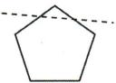
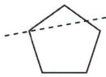
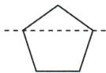

> [!success]- 必刷题
>
> > [!success] **【答案】** 详见解析
>
> > [!note]- **【解析】**
> > 【解】①当不过五边形的任意一个顶点切时,得到的多边形有6条边,如图(1)所示;
> > - **②**：当只过五边形的一个顶点切时,得到的多边形有5条边,如图(2)所示;
> > - **③**：当过五边形的两个顶点切时,得到的多边形有4条边,如图(3)所示.
> >
> > 
> >
> > 
> > 图(1)
> >
> > 
> > 图(2)
> > 图(3)
> >
> > 归纳总结
> > 从 n 边形 (n > 3) 的一个顶点出发, 可以引 (n - 3) 条对角线, 将这个 n 边形分成 (n - 2) 个三角形. 一个 n 边形共有 n 条边, n 个角, n 个顶点, $\frac{n(n-3)}{2}$ 条对角线.
