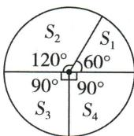

> [!success]- 必刷题
>
> > [!success] **【答案】** 36π
>
> > [!note]- **【解析】**
> > 由题图(1)易得∠AOB= $\frac{360^{\circ}}{6}$ =
> > 60°. 因为 OC = OD = $\frac{1}{5}$ OA, 所以 OC = OD = $\frac{1}{4}AC=\frac{1}{4}\times12=3(cm)$ , 所以 OA=OC+AC=3+
> > 12=15(cm), 所以 $S_{摆盘}=S_{扇形AOB}-S_{扇形COD}=\frac{60}{360}\times(\pi\times15^{2}-\pi\times3^{2})=36\pi(cm^{2})$ .
> >
> > 
