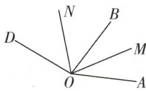

<!-- question-source:start -->
6 如图, 已知射线 OB, OM, ON 在 $\angle AOD$ 内部, OM 平分 $\angle AOB$ , ON 平分 $\angle BOD$ .
(1) 若 $\angle AOD = 156^{\circ}$ , $\angle DON = 48^{\circ}$ , 求 $\angle MON$ 的度数;

(2) 若 $\angle AOD = \alpha^{\circ}$ ，试说明 $\angle MON = \frac{1}{2}\alpha^{\circ}$ .

<!-- question-source:end -->

![[Q00096488A1]]
