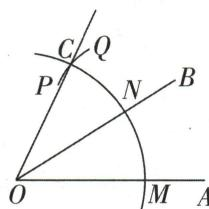

<!-- question-source:start -->
7[2024 吉林长春期末]如图, 已知 $\angle AOB$ , 用尺规以 $OB$ 为一边在 $\angle AOB$ 的外部作 $\angle COB = \angle AOB$ , 对于弧 $PQ$ , 下列说法正确的是

( )

A. 以点 M 为圆心, OM 的长为半径  
B. 以点 N 为圆心, MN 的长为半径  
C. 以点 O 为圆心, OM 的长为半径  
D. 以点 N 为圆心, ON 的长为半径
<!-- question-source:end -->

![[Q00096489A1]]
