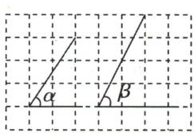
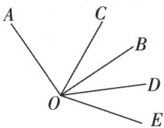

<!-- question-source:start -->
1[2025 山西太原期中, 中]如图, 正方形网格中每个小正方形的边长都为 1 , 则 $\angle \alpha$ 与 $\angle \beta$ 的大小关系为 ( )
A. $\angle \alpha < \angle \beta$ B. $\angle \alpha = \angle \beta$ C. $\angle \alpha > \angle \beta$ D. 无法估测

  
(第1题图)

  
(第2题图)
<!-- question-source:end -->

![[Q00096492A1]]
