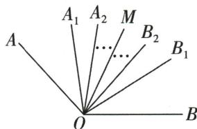

<!-- question-source:start -->
1 [2024 河北唐山期中, 中] 如图, $\angle AOB = \alpha$ , $OA_{1}, OB_{1}$ 分别是 $\angle AOM$ 和 $\angle MOB$ 的平分线, $OA_{2}, OB_{2}$ 分别是 $\angle A_{1}OM$ 和 $\angle MOB_{1}$ 的平分线, $OA_{3}, OB_{3}$ 分别是 $\angle A_{2}OM$ 和 $\angle MOB_{2}$ 的平分线, $\cdots$ , $OA_{n}, OB_{n}$ 分别是 $\angle A_{n-1}OM$ 和 $\angle MOB_{n-1}$ 的平分线, 则 $\angle A_{n}OB_{n}$ 的度数是 ( )

A. $\frac{\alpha}{n}$ B. $\frac{\alpha}{2^{n - 1}}$ C. $\frac{\alpha}{2^n}$ D. $\frac{\alpha}{n^2}$
<!-- question-source:end -->
