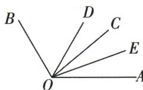

<!-- question-source:start -->
2[2024 江苏无锡期末, 中](1) 如图, 若 $\angle AOB = 120^{\circ}$ , $\angle AOC = 40^{\circ}$ , OD, OE 分别平分 $\angle AOB$ , $\angle AOC$ , 求 $\angle DOE$ 的度数;

(2) 若 $\angle AOB, \angle AOC$ 是平面内两个角, $\angle AOB = m^{\circ}, \angle AOC = n^{\circ} (0 < n < m < 180)$ , $OD, OE$ 分别平分 $\angle AOB, \angle AOC$ , 求 $\angle DOE$ 的度数. (用含 $m, n$ 的代数式表示)

<!-- question-source:end -->
