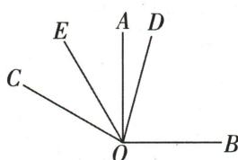

<!-- question-source:start -->
3[2024 内蒙古包头东河区期末, 中]如图, 已知在同一平面内, $\angle AOB = 90^{\circ}, \angle AOC = 60^{\circ}$ .

(1) 填空: $\angle BOC =$ \_\_\_\_;

(2) 如果 OD 平分 $\angle BOC, OE$ 平分 $\angle AOC$ ，求 $\angle DOE$ 的度数；

(3) 如果在 (2) 的条件下将 $\angle AOC = 60^{\circ}$ 改为 $\angle AOC = 2\alpha$ ( $0^{\circ} < \alpha < 45^{\circ}$ ), 其他条件不变, 求 $\angle DOE$ 的度数.

<!-- question-source:end -->
