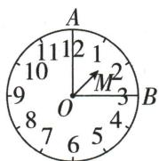
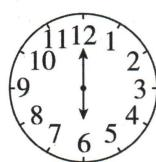

<!-- question-source:start -->
15[2025 山东青岛期中]时钟是我们日常生活中常见的生活用品,钟表上的时针和分针都绕其轴心旋转,表盘中数字 1\~12 均匀分布,分针转动一周(360°)需要 60 分,时针转动一周的 $\frac{1}{12}$ 需要 60 分,这样,分针的转速为每分转 6°,时针的转速为每分转 $\left(\frac{1}{2}\right)^{\circ}$ .

【课题学习】

3:20 时, 时针与分针所成角为多少度? 解决这个问题, 可以先考虑三点整, 时针与分针所成角为 $90^{\circ}$ ; 从 3:00 到 3:20, 我们可以先计算分针转动的角度: $20 \times 6^{\circ} = 120^{\circ}$ , 时针转动的角度: $20 \times \left(\frac{1}{2}\right)^{\circ} = 10^{\circ}, 120^{\circ} - (90^{\circ} + 10^{\circ}) = 20^{\circ}$ . 故 3:20 时, 时针与分针所成角是 $20^{\circ}$ .

【问题解决】

(1) 当 3:30 时, 时针与分针所成角的度数

是\_\_\_\_。

(2)如图(1),表盘上的点A对应数字“12”,点B对应数字“3”,若分针OM从OA的位置开始转动,经过多少分,OM第一次平分∠AOB?
(3)当时针和分针所成角为 $180^{\circ}$ 时,形成一条直线,这条直线刚好平分钟面,我们将这样的时刻称为“美妙时刻”,如图(2),六点整就是一个“美妙时刻”,从0时到24时共有\_\_\_\_个“美妙时刻”.

图(1)

图(2)
<!-- question-source:end -->

![[Q00098424A1]]
