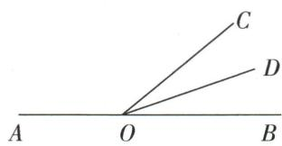
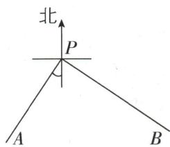

<!-- question-source:start -->
6[2023 四川乐山中考]如图, 点 O 在直线 AB 上, OD 是 $\angle BOC$ 的平分线, 若 $\angle AOC = 140^{\circ}$ , 则 $\angle BOD$ 的度数为 \_\_\_\_.

(第6题图)

(第7题图)
<!-- question-source:end -->

![[Q00103032A1]]
