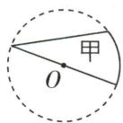
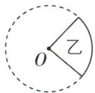
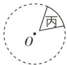

<!-- question-source:start -->
9[2023 江苏连云港中考]如图,甲是由一条直径、一条弦及一段圆弧所围成的图形;乙是由两条半径与一段圆弧所围成的图形;丙是由不过圆心 O 的两条线段与一段圆弧所围成的图形.下列叙述正确的是()

A.只有甲是扇形 B.只有乙是扇形C.只有丙是扇形 D.只有乙、丙是扇形
<!-- question-source:end -->

![[Q00103035A1]]
