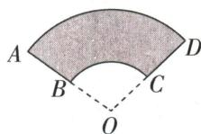

<!-- question-source:start -->
10[2024 甘肃中考]甘肃临夏砖雕是一种历史悠久的古建筑装饰艺术, 是第一批国家级非物质文化遗产. 如图(1)是一块扇面形的临夏砖雕作品, 它的部分设计图如图(2), 其中扇形 OBC 和扇形 OAD 有相同的圆心 O, 且圆心角 $\angle O = 100^{\circ}$ , 若 OA = 120 cm, OB = 60 cm, 则阴影部分的面积是 \_\_\_\_ cm². (结果用 $\pi$ 表示)

图(1)

图(2)
<!-- question-source:end -->

![[Q00103036A1]]
