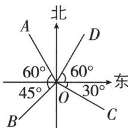

<!-- question-source:start -->
3[2024 湖南长沙期末]如图,下列说法错误的是()

A. $OA$ 的方向是北偏西 $60^{\circ}$ B. $OB$ 的方向是西南方向
C. $OC$ 的方向是南偏东 $60^{\circ}$ D. $OD$ 的方向是北偏东 $30^{\circ}$

图(1)

<!-- question-source:end -->

![[Q00103039A1]]
