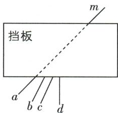

> [!success]- 必刷题
>
> > [!success] **【答案】** A
>
> > [!note]- **【解析】**
> > 利用直尺画出图形如下：
> >
> > 
> >
> > 可以看出线段 a 与 m 在一条直线上. 故选 A.
> >
> > 2.5 【解析】由画图过程知 $AD = AB = 5$ . 故答案为5.
> >
> > 3.4 【解析】根据线段的中点的定义可得 AB = 2AC = 2×2 = 4(cm)，故答案为 4.
