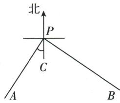

> [!success]- 必刷题
>
> > [!success] **【答案】** 90
>
> > [!note]- **【解析】**
> > 如图,由题意得 $\angle APC = 34^{\circ}$ , $\angle BPC = 56^{\circ}$ , 所以 $\angle APB = \angle APC + \angle BPC = 90^{\circ}$ , 故答案为 90.
> >
> > 
> >
> > 归纳总结
> > 从多边形的一个顶点出发,可以画出的对角线的条数是得到的三角形个数减1,多边形边数是得到的三角形个数加2.
> >
> > 8.2 【解析】从五边形的一个顶点出发可以引出的对角线条数为 5-3=2. 故答案为 2.
