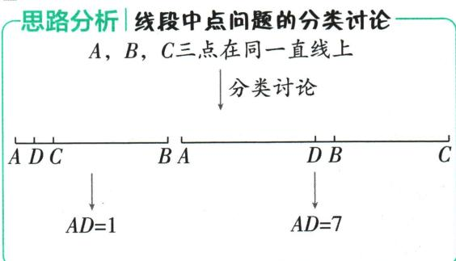

> [!success]- 必刷题
>
> > [!success] **【答案】** C
>
> > [!note]- **【解析】**
> > 
> > 【解析】当点 C 在线段 AB 上时, 因为 AB = 8, BC = 6, 所以 AC = 2. 因为点 D 是线段 AC 的中点, 所以 AD = 1. 当点 C 在线段 AB 的延长线上时, 因为 AB = 8, BC = 6, 所以 $AC = 8 + 6 = 14$ . 因为点 D 是线段 AC 的中点, 所以 AD = 7. 故线段 AD 的长为 1 或 7,
> >
> > 故选 **C**.
