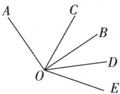
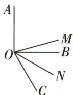
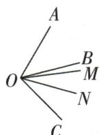
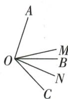

## 全章综合训练 刷中考

(第1题图)

  
(第2题图)

![[初中/课堂同步/教辅/必刷题/2026版《初中必刷题》数学 BS  7上/04_第四章_基本平面图形/全章综合训练/questions/Q00098379.md]]
![[初中/课堂同步/教辅/必刷题/2026版《初中必刷题》数学 BS  7上/04_第四章_基本平面图形/全章综合训练/questions/Q00098380.md]]
![[初中/课堂同步/教辅/必刷题/2026版《初中必刷题》数学 BS  7上/04_第四章_基本平面图形/全章综合训练/questions/Q00098381.md]]
![[初中/课堂同步/教辅/必刷题/2026版《初中必刷题》数学 BS  7上/04_第四章_基本平面图形/全章综合训练/questions/Q00098382.md]]
## e刷素养

核心素养推理能力[2025湖南长沙期末,较难]如图,OM是∠AOC的平分线,ON是∠BOC的平分线.
(1) 如图(1), 当∠AOB 是直角, ∠BOC = 60° 时, ∠MON 的度数是多少?
(2) 如图(2), 当∠AOB = α, ∠BOC = 60° 时, 猜想∠MON与α的数量关系, 并说明理由.
(3) 如图(3), 当∠AOB = α, ∠BOC = β 时, ∠MON 与 α, β 有数量关系吗? 如果有, 请写出结论并说明理由.

  
图(1)

  
图(2)

  
图(3)

建议用时-25分钟 答案-D40

## 母题学大招6 两个角无公共部分
