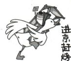

## 全章综合训练 刷章测

![[初中/课堂同步/教辅/必刷题/2026版《初中必刷题》数学 BS  7上/04_第四章_基本平面图形/全章综合训练/questions/Q00098383.md]]
## 母题学大招7 两个角有公共部分

![[初中/课堂同步/教辅/必刷题/2026版《初中必刷题》数学 BS  7上/04_第四章_基本平面图形/全章综合训练/questions/Q00098384.md]]
## © 子题练变式

![[初中/课堂同步/教辅/必刷题/2026版《初中必刷题》数学 BS  7上/04_第四章_基本平面图形/全章综合训练/questions/Q00098385.md]]
## 母题学大招8 三个角围成周角

![[初中/课堂同步/教辅/必刷题/2026版《初中必刷题》数学 BS  7上/04_第四章_基本平面图形/全章综合训练/questions/Q00098386.md]]
