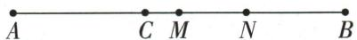

<!-- question-source:start -->
1[2024 河南许昌期末, 中]如图, 点 C 是线段 AB 上的一点, 且 AC < BC, M 和 N 分别是 AB 和 BC 的中点, 已知 AC = 10, NB = 7, 则线段 MN 的长度是 ( )

A.3 B.3.5 C.4 D.5
<!-- question-source:end -->

![[Q00096466A1]]
