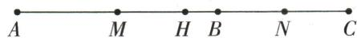

<!-- question-source:start -->
4[2024新疆乌鲁木齐校级期末,中]如图,点A,
B,C在同一直线上,H为AC的中点,M为AB的
中点,N为BC的中点,则下列说法:①MN=HC;
② $MN=\frac{1}{2}(AC+HB)$ ; ③ $MH=\frac{1}{2}(AH-HB)$ ;
④ $HN=\frac{1}{2}(HC+HB)$ ,其中正确的是（）
A M H B N C
A. ①③ B. ②④
C. ①④ D. ①③④

<!-- question-source:end -->

![[Q00102980A1]]
