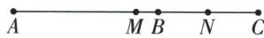

> [!success]- 必刷题
>
> > [!success] **【答案】** 详见解析
>
> > [!note]- **【解析】**
> > 【解】(1)因为 $AC = 9 \mathrm{~cm}$ , 点 $M$ 是 $AC$ 的中点, 可得答案.
> >
> > ## 思路分析
> >
> > (1) 由中点的定义得 CM = $\frac{1}{2}AC, CN=$ $\frac{1}{2}BC$ , 再根据 $MN = CM + CN$
> >
> > 所以 $CM=\frac{1}{2}AC=4.5\ cm$ .
> > 因为 BC=6 cm, 点 N 是 BC 的中点,
> > 所以 $CN=\frac{1}{2}BC=3\ cm$ ,
> > 所以 $MN = CM + CN = 7.5 \, cm$ ,
> > 所以线段 MN 的长度为 7.5 cm.
> > (2) $MN=\frac{1}{2}a\ cm$ . 理由: 因为 C 为线段 AB 上一点, 且 M, N 分别是 AC, BC 的中点,
> > 所以 $MN = MC + CN = \frac{1}{2}(AC + BC) = \frac{1}{2}a\ cm$ .
> > (3)能. 当点 C 在线段 AB 的延长线上时, 如图, $MN=\frac{1}{2}b\ cm$ .
> >
> > 
> >
> > 理由: 因为 M 是 AC 的中点,
> > 所以 $CM=\frac{1}{2}AC.$ 因为点 N 是 BC 的中点，
> > 所以 $CN=\frac{1}{2}BC$ ,
> > 所以 $MN = CM - CN = \frac{1}{2}(AC - BC) = \frac{1}{2}b \, \text{cm}.$
