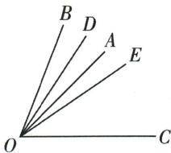

> [!success]- 必刷题
>
> > [!success] **【答案】** C
>
> > [!note]- **【解析】**
> > 因为 $\angle AOB = \alpha, OA_{1}, OB_{1}$ 分别是 $\angle AOM$ 和 $\angle MOB$ 的平分线，所以 $\angle A_{1}OM = \frac{1}{2}\angle AOM, \angle B_{1}OM = \frac{1}{2}\angle BOM$ ，所以 $\angle A_{1}OB_{1} = \frac{1}{2} (\angle AOM + \angle BOM) = \frac{1}{2}\angle AOB = \frac{1}{2}\alpha;$ 因为 $OA_{2}, OB_{2}$ 分别是 $\angle A_{1}OM$ 和 $\angle MOB_{1}$ 的平分线，所以 $\angle A_{2}OM = \frac{1}{2}\angle A_{1}OM, \angle B_{2}OM = \frac{1}{2}\angle B_{1}OM,$ 所以 $\angle A_{2}OB_{2} = \frac{1}{2} (\angle A_{1}OM + \angle B_{1}OM) = \frac{1}{2}\angle A_{1}OB_{1} = \frac{1}{2} \times \frac{1}{2}\angle AOB = \frac{\alpha}{2^{2}};$ 因为 $OA_{3}, OB_{3}$ 分别是 $\angle A_{2}OM$ 和 $\angle MOB_{2}$ 的平分线，所以 $\angle A_{3}OM = \frac{1}{2}\angle A_{2}OM, \angle B_{3}OM = \frac{1}{2}\angle B_{2}OM,$ 所以 $\angle A_{3}OB_{3} = \frac{1}{2} (\angle A_{2}OM + \angle B_{2}OM) = \frac{1}{2}\angle A_{2}OB_{2} = \frac{1}{2} \times \frac{1}{2}\angle A_{1}OB_{1} = \frac{1}{2} \times \frac{1}{2} \times \frac{1}{2}\angle AOB = \frac{\alpha}{2^{3}}; \cdots,$ 由此规律得 $\angle A_{n}OB_{n} = \frac{\alpha}{2^{n}}$ ，故选 C.
> >
> > 大招解读 两个角有公共部分
> > 条件:如图,OD,OE 分别平分∠AOB,∠BOC
> >
> > 
> >
> > 结论: $\angle DOE=\frac{1}{2}\angle AOC$
