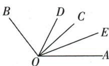
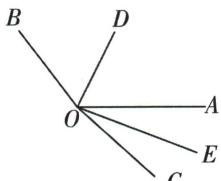

> [!success]- 必刷题
>
> > [!success] **【答案】** B
>
> > [!note]- **【解析】**
> > 【解】(1) 因为 $\angle AOB = 120^{\circ}$ , OD 平分 $\angle AOB$ ,
> > 所以 $\angle AOD = \angle BOD = \frac{1}{2} \angle AOB = 60^{\circ}$ . 因为 OE 平分 $\angle AOC, \angle AOC = 40^{\circ}$ ，所以 $\angle AOE = \frac{1}{2} \angle AOC = 20^{\circ}$ ，所以 $\angle DOE = \angle AOD - \angle AOE = 60^{\circ} - 20^{\circ} = 40^{\circ}$ .
> > (2) 若射线 OC 在 $\angle AOB$ 的内部, 如图(1). 因为 $\angle AOB = m^{\circ}, \angle AOC = n^{\circ}, OD, OE$ 分别平分 $\angle AOB, \angle AOC$ ，所以 $\angle DOE = \angle AOD - \angle AOE = \frac{1}{2} \angle AOB - \frac{1}{2} \angle AOC = \frac{1}{2}(m-n)^{\circ}$ ，所以当射线 OC 在 $\angle AOB$ 的内部时， $\angle DOE = \frac{1}{2}(m-n)^{\circ}$ .
> >
> > (1)根据角平分线定义求出 $\angle AOD$ 和 $\angle AOE$ 的度数,即可得出答案;
> >
> > 
> > 图(1)
> >
> > 
> > 图(2)
> >
> > (2) 由于无法确定射线 OC 的位置, 所以需要分射线 OC 在 $\angle AOB$ 的内部和射线 OC 在 $\angle AOB$ 的外部两种情况, 画出相应的图形, 根据角平分线的定义与角的和差求解即可.
> >
> > 若射线 OC 在 $\angle AOB$ 外部, 如图(2). 因为 $\angle AOB = m^{\circ}, \angle AOC = n^{\circ}, OD, OE$ 分别平分 $\angle AOB, \angle AOC$ , 所以 $\angle DOE = \angle AOD + \angle AOE = \frac{1}{2} \angle AOB + \frac{1}{2} \angle AOC = \frac{1}{2}(n+m)^{\circ}$ , 所以当射线 OC 在 $\angle AOB$ 的外部时, $\angle DOE = \frac{1}{2}(n+m)^{\circ}$ .
