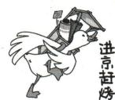

## 大招专题 3 双角平分线模型

![[初中/课堂同步/教辅/必刷题/2026版《初中必刷题》数学 BS  7上/04_第四章_基本平面图形/大招专题_3_双角平分线模型/questions/Q00103009.md]]

## 母题学大招7 两个角有公共部分

![[初中/课堂同步/教辅/必刷题/2026版《初中必刷题》数学 BS  7上/04_第四章_基本平面图形/大招专题_3_双角平分线模型/questions/Q00103010.md]]

## © 子题练变式

![[初中/课堂同步/教辅/必刷题/2026版《初中必刷题》数学 BS  7上/04_第四章_基本平面图形/大招专题_3_双角平分线模型/questions/Q00103011.md]]

## 母题学大招8 三个角围成周角

![[初中/课堂同步/教辅/必刷题/2026版《初中必刷题》数学 BS  7上/04_第四章_基本平面图形/大招专题_3_双角平分线模型/questions/Q00103012.md]]
