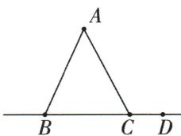

<!-- question-source:start -->
5[2025 福建龙岩质检]如图,以 A, B, C, D 中的任意一点为端点,在图中找到不同的射线条数为 ( )

  
不做题
我就跺脚鸭

A. 5 B. 6 C. 7 D. 8

6往返于甲、乙两地的火车,中途停靠三站,每两站间距离各不相等,需要准备\_\_\_\_种不同的车票.
<!-- question-source:end -->

![[Q00096447A1]]
