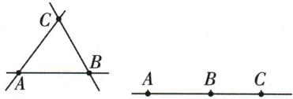
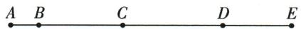

> [!success]- 必刷题
>
> > [!success] **【答案】** B
>
> > [!note]- **【解析】**
> > 以 B, C, D 中的任意一点为端点的射线各有 2 条, 所以在题图中不同的射线共有 6 条. 故选 B.
> >
> > 6.20 【解析】如图, $A, E$ 两点代表甲、乙两地, 点 $B, C, D$ 分别代表中途停靠的三站, 所以不同长度的线段条数就代表车票的种类数, 即线段 AB, AC, AD, AE, BC, BD, BE, CD, CE, DE, 共 10 条, 考虑到往返车票要区别开, 所以需要准备 $10 \times 2 = 20$ (种) 不同的车票.
> >
> > 
> > 3条:直线AB,
> > BC,AC
> >
> > 
