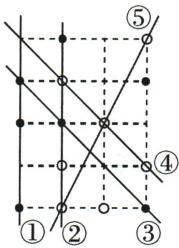

> [!success]- 必刷题
>
> > [!success] **【答案】** B
>
> > [!note]- **【解析】**
> > 如图,使三枚颜色相同的棋子在同一直线上的直线共有 5 条.
> >
> > 
> >
> > 知识归纳←----最短. 故选 B.
> >
> > 两点之间的连线,可以有无数种连法,如折线、曲线、线段等.这些所有的连线中,线段最短.简单说成两点之间线段最短.
