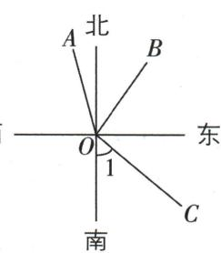
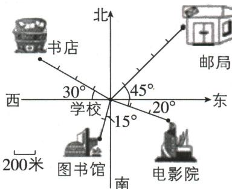

<!-- question-source:start -->
9[2025 广东汕头期末]如图, 点 A 在点 O 的北偏西 $15^{\circ}$ 方向, 点 B 在点 O 的北偏东 $35^{\circ}$ 方向, 若 $\angle 1 = \angle AOB$ , 则点 C 在点 O 的 \_\_\_\_ 方向.

  
(第9题图)

  
(第 10 题图)
<!-- question-source:end -->
