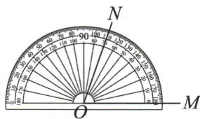
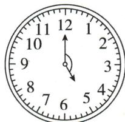

<!-- question-source:start -->
5 如图所示, 用量角器度量 $\angle MON$ , 可以读出 $\angle MON$ 的度数为 ( )
A. $60^{\circ}$ B. $70^{\circ}$ C. $110^{\circ}$ D. $115^{\circ}$

(第5题图)

(第7题图)
<!-- question-source:end -->

![[Q00102988A1]]
