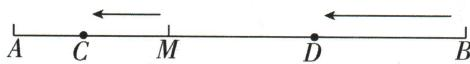

<!-- question-source:start -->
5[较难]如图,M 是定长线段 AB 上一定点,C,D 两点分别从 M,B 出发,以 1 cm/s,3 cm/s 的速度沿直线 BA 向左运动,运动方向如箭头所示 (C 在线段 AM 上,D 在线段 BM 上).

(1) 若 $AB = 10 \mathrm{~cm}$ , 当点 $C, D$ 运动了 $2 \mathrm{~s}$ 时, 求 $AC + MD$ 的值.

(2) 若点 C, D 运动时, 总有 MD = 3AC, 直接填空: AM = \_\_\_\_ AB.

(3)在(2)的条件下,N是直线AB上一点,且 $AN-BN=MN$ ,求 $\frac{MN}{AB}$ 的值.

<!-- question-source:end -->

![[Q00096464A1]]
