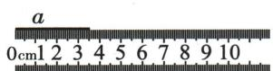
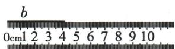
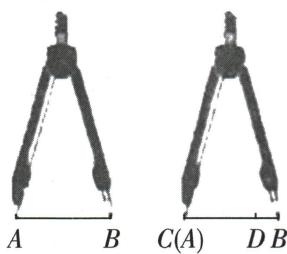

<!-- question-source:start -->
4 如图所示, 比较线段 a 和线段 b 的长度, 结果正确的是 ( )

A. $a > b$ B. $a <   b$ C. $a = b$ D.无法确定

5有不在同一直线上的两条线段 $AB$ 和 $CD$ , 李明很难判断出它们的长短, 因此他借助于圆规, 操作如图所示, 由此可得出 AB \_\_\_\_ CD. (填“>”“<”或“=”)

<!-- question-source:end -->
