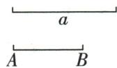

<!-- question-source:start -->
10 如图, 已知线段 AB 和线段 a, 延长线段 AB 至点 C, 使 BC = 2a, 延长 BA 至点 D, 使点 B 是 CD 的中点.

(1) 用尺规作出图形, 并标出相应的字母;
(保留作图痕迹, 不写作法)
(2) 若 AB = 1, a = 1.5, 求 AD 的长.

<table><tr><td></td></tr><tr><td></td></tr></table>
<!-- question-source:end -->
