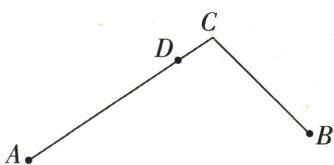

<!-- question-source:start -->
4[较难]如图,有公共端点 C 的两条线段 AC, BC 组成一条折线 A-C-B, 若该折线 A-C-B 上一点 D 把这条折线分成相等的两部分, 我们把这个点 D 叫作这条折线的“折中点”.

(1) 若 AC = BC，则点 D 与点 \_\_\_\_ 重合；

(2) 若 E 为线段 AC 的中点, $EC = 5 \, cm$ , CD = 2 cm, 则 BC 的长为 \_\_\_\_.

<!-- question-source:end -->
