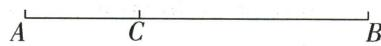
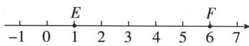

<!-- question-source:start -->
6 思想方法 分类讨论 [较难] 点 $C$ 在线段 $AB$ 上, 若 $BC = 2AC$ 或 $AC = 2BC$ , 则称点 $C$ 是线段 $AB$ 的 “雅点”, 线段 $AC, BC$ 互为“雅点”伴侣线段.

(1)如图(1),若点 C 为线段 AB 的“雅点”,AC=6(AC<BC),则 AB=\_\_\_\_;

(2)如图(2),数轴上有一点E表示的数为1,向右平移5个单位到达点F.若点G在射线EF上,且线段GF与以E,F,G中某两个点为端点的线段互为“雅点”伴侣线段,请写出点G所表示的数.(写出必要的推理步骤)

  
图(1)

  
图(2)
<!-- question-source:end -->
