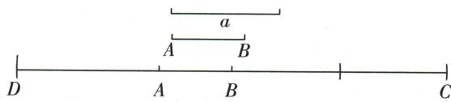

> [!success]- 必刷题
>
> > [!success] **【答案】** 详见解析
>
> > [!note]- **【解析】**
> > 【解】(1)如图.
> >
> > 
> >
> > (2) 因为 $a = 1.5$ , 所以 $BC = 2a = 3$ . 因为 $B$ 是 $CD$ 的中点, 所以 $BD = CB = 3$ . 因为 $AB = 1$ , 所以 $AD = BD - AB = 3 - 1 = 2$ .
