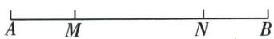
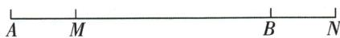

> [!success]- 必刷题
>
> > [!success] **【答案】** $\frac{1}{4}$
>
> > [!note]- **【解析】**
> > 【解】(1)当点 C, D 运动了 2 s 时, CM = 2 cm, BD = 6 cm. 又因为 AB = 10 cm, 所以 AC + MD = AB - CM - BD = 10 - 2 - 6 = 2 (cm).
> >
> > (2) 设运动时间为 t s, 则 CM = t cm, BD = 3 t cm. 因为 AC = AM - t, MD = BM - 3t, MD = 3AC, 所以 BM - 3t = 3 (AM - t), 即 BM = 3AM. 因为 BM = AB - AM, 所以 AB - AM = 3AM, 所以 AM = $\frac{1}{4}$ AB. 故答案为 $\frac{1}{4}$ .
> >
> > (3)①当点 N 在线段 AB 上时, 如图(1).
> >
> > 
> > 图(1)
> >
> > 因为 AN-BN=MN, AN-AM=MN, 所以 BN= $AM=\frac{1}{4}AB$ , 所以 $MN=\frac{1}{2}AB$ , 即 $\frac{MN}{AB}=\frac{1}{2}$ .
> > - **②**：当点 N 在线段 AB 的延长线上时, 如图(2).
> >
> > 
> > 图(2)
> >
> > 因为 AN-BN=MN, AN-BN=AB, 所以 MN=AB,
> > 即 $\frac{MN}{AB}=1$ . 综上所述, $\frac{MN}{AB}$ 的值为 $\frac{1}{2}$ 或1.
> >
> > ## 刷素养·
