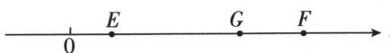
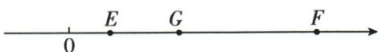
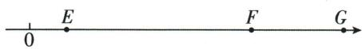

> [!success]- 必刷题
>
> > [!success] **【答案】** 18
>
> > [!note]- **【解析】**
> > 【解】(1)因为点 C 为线段 AB 的“雅点”, AC = 6 (AC < BC), 所以 BC = 2AC = 12, 所以 AB = AC + BC = 18. 故答案为 18.
> > (2) 因为点 G 在射线 EF 上, 且线段 GF 与以 E, F, G 中某两个点为端点的线段互为“雅点”伴侣线段, 所以分以下四种情况:
> > - **①**：当 G 在线段 EF 上且 EG = 2FG 时, 如图(1).
> >
> > 
> > 图(1)
> >
> > 因为 $EG = 2FG, EG + FG = 5$ ，所以 $EG = \frac{10}{3}$ 。
> > 因为 $E$ 表示的数为 1，
> > 所以 $G$ 表示的数为 $1 + \frac{10}{3} = \frac{13}{3}$ 。
> > - **②**：当 $G$ 在线段 $EF$ 上且 $FG = 2EG$ 时，如图(2).
> >
> > 
> > 图(2)
> >
> > 图(3)
> >
> > 因为 $FG = 2EG, EG + FG = 5$ ，所以 $EG = \frac{5}{3}$ 。因为 $E$ 表示的数为 1，所以 $G$ 表示的数为 $1 + \frac{5}{3} = \frac{8}{3}$ 。
> > - **③**：当 $G$ 在线段 $EF$ 的延长线上且 $EF = 2FG$ 时，如图(3)。
> >
> > 
> >
> > $$
> > E F = 2 F G, E F = 5
> > $$
> >
> > $$
> > F G = 2. 5
> > $$
> >
> > $$
