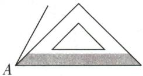
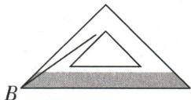

<!-- question-source:start -->
1 如图,用同样大小的三角板比较 $\angle A$ 和 $\angle B$ 的大小,下列判断正确的是()

A. $\angle A > \angle B$ B. $\angle A < \angle B$ C. $\angle A = \angle B$ D.没有量角器，无法确定
<!-- question-source:end -->
