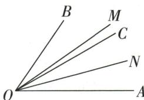

<!-- question-source:start -->
3 如图, 已知 ON, OM 分别平分 $\angle AOC$ 和 $\angle BON$ . 若 $\angle MON = 20^{\circ}, \angle AOM = 35^{\circ}$ , 则 $\angle AOB$ 的度数为 ( )

A. $15^{\circ}$ B. $40^{\circ}$ C. $55^{\circ}$ D. $70^{\circ}$
<!-- question-source:end -->
