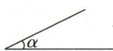
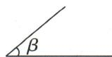

<!-- question-source:start -->
8[2025 江西吉安期末]作图题(尺规作图,不写作法,但保留作图痕迹).
如图,已知 $\angle\alpha,\angle\beta$ . 求作 $\angle AOB$ , 使 $\angle AOB = 2\angle\alpha + \angle\beta$ .

2 刷易错 小心有坑\~

<!-- question-source:end -->
