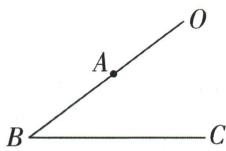

<!-- question-source:start -->
5[2024 辽宁阜新海州区校级期中, 中]如图, 点 A 是 $\angle OBC$ 的边 BO 上一点, 以 A 为顶点, 射线 AO 为一边, 在 $\angle OBC$ 外用尺规作 $\angle OAD$ , 使其等于 $\angle ABC$ (不写作法,保留作图痕迹).

<!-- question-source:end -->

![[Q00103007A1]]
