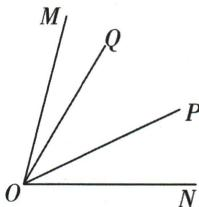
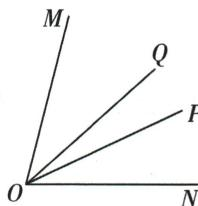
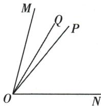
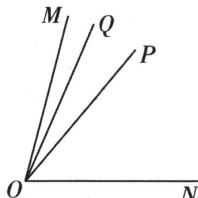

> [!success]- 必刷题
>
> > [!success] **【答案】** C
>
> > [!note]- **【解析】**
> > - **①**：如图(1)，当 $\angle MOP = 2\angle NOP, \angle QOP = 2\angle MOQ$ 时，因为 $\angle MOQ = x$ ，所以 $\angle QOP = 2x, \angle NOP = \frac{1}{2}\angle MOP = \frac{1}{2} \times$
> >
> >   
> > 图(1)
> >
> > $(x+2x)=\frac{3}{2}x$ ，所以 $\angle MON=\angle MOQ+\angle QOP+$ $\angle NOP = x + 2x + \frac{3}{2}x = \frac{9}{2}x;$
> > - **②**：如图（2），当 $\angle MOP = 2\angle NOP, \angle MOQ = 2\angle QOP$ 时，因为 $\angle MOQ = x$ ，所以 $\angle QOP = \frac{1}{2} x, \angle NOP = \frac{1}{2}\angle MOP = \frac{1}{2}\times \left(x + \frac{1}{2} x\right) =$
> >
> >   
> > 图(2)
> >
> > $\frac{3}{4}x$ , 所以 $\angle MON = \angle MOQ + \angle QOP + \angle NOP =$
> >
> > $x+\frac{1}{2}x+\frac{3}{4}x=\frac{9}{4}x;$ ③如图（3），当 $\angle NOP = 2\angle MOP, \angle MOQ = 2\angle QOP$ 时，因为 $\angle MOQ = x$ ，所以 $\angle QOP = \frac{1}{2}x, \angle NOP =$
> >
> >   
> > 图(3)
> >
> > $2\angle MOP=2\times\left(x+\frac{1}{2}x\right)=3x$ ，所以 $\angle MON=$ $\angle MOQ + \angle QOP + \angle NOP = x + \frac{1}{2}x + 3x = \frac{9}{2}x;$
> > - **④**：如图（4），当 $\angle NOP = 2\angle MOP, \angle QOP = 2\angle MOQ$ 时，因为 $\angle MOQ = x$ ，所以 $\angle QOP = 2x, \angle NOP = 2\angle MOP = 2\times (x + 2x) = 6x,$
> >
> >   
> > 图(4)
> >
> > 所以 $\angle MON = \angle MOQ + \angle QOP + \angle NOP = x + 2x + 6x = 9x.$ 综上， $\angle MON = \frac{9}{4} x$ 或 $\frac{9}{2} x$ 或 $9x$ ，
> >
> > 故选 **C**.
