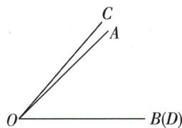

> [!success]- 必刷题
>
> > [!success] **【答案】** ①
>
> > [!note]- **【解析】**
> > 因为 $\angle AOB = 45^{\circ}, \angle COD = 50^{\circ}$ , 所以 $\angle AOB < \angle COD$ , 所以用叠合法比较如图所示, $OA$ 在
> >
> > 
> >
> > ∠COD 的内部. 故答案为①.
