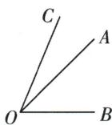
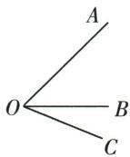

> [!success]- 必刷题
>
> > [!success] **【答案】** A
>
> > [!note]- **【解析】**
> > 易知①符合题意;
> > - **②**：如图(1), $\angle AOB = 2\angle AOC$ , 但 $OC$ 不平分 $\angle AOB$ , 故②不符合题意;
> > - **③**：不确定 $\angle AOC$ 与 $\angle COB$ 的大小, 故不能确定 $OC$ 平分 $\angle AOB$ , 故③不符合题意;
> > - **④**：如图(2), $\angle BOC = \frac{1}{2}\angle AOB$ , 但 $OC$ 不平分 $\angle AOB$ , 故④不符合题意. 故选A.
> >
> > 
> > 图(1)
> >
> > 
> > 图(2)
