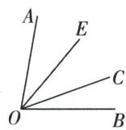
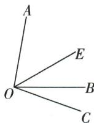

> [!success]- 必刷题
>
> > [!success] **【答案】** $30^{\circ}$ 或 $50^{\circ}$
>
> > [!note]- **【解析】**
> > 若射线 OC 在 $\angle AOB$ 的内部, 如图(1). 因为 $\angle AOB = 80^{\circ}, \angle BOC = 20^{\circ}$ , 所以 $\angle AOC = 60^{\circ}$ . 因为 OE 平分 $\angle AOC$ , 所以 $\angle AOE = 30^{\circ}$ .
> >
> > 易错警示
> > 要考虑到射线OC在∠AOB的内部和外部两种情况.
> >
> > 
> >
> > 
> > 图(1)
> > 图(2)
> >
> > 若射线 OC 在 $\angle AOB$ 外部, 如图(2). 因为 $\angle AOB = 80^{\circ}, \angle BOC = 20^{\circ}$ , 所以 $\angle AOC = 100^{\circ}$ . 因为 OE 平分 $\angle AOC$ , 所以 $\angle AOE = 50^{\circ}$ . 故答案为 $30^{\circ}$ 或 $50^{\circ}$ .
