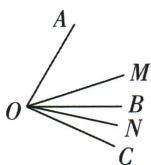
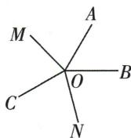
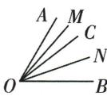

> [!success]- 必刷题
>
> > [!success] **【答案】** 30°或150°
>
> > [!note]- **【解析】**
> > 因为OM平分∠AOC, ON
> > 平分∠BOC, 所以∠MOC= $\frac{1}{2}$ ∠AOC, ∠CON=∠BON= $\frac{1}{2}$ ∠BOC. 如图(1), ∠MON=∠MOC-∠CON= $\frac{1}{2}$ (∠AOC-∠BOC)= $\frac{1}{2}$ ×60°=30°; 如图(2), ∠MON=∠MOC+∠CON= $\frac{1}{2}$ (∠AOC+∠BOC)= $\frac{1}{2}$ (360°-∠AOB)= $\frac{1}{2}$ ×300°=150°; 如图(3), ∠MON=∠MOC+∠CON= $\frac{1}{2}$ (∠AOC+∠BOC)= $\frac{1}{2}$ ×60°=30°. 综上所述, ∠MON的度数为30°或150°.
> >
> > 
> >
> > 
> > 图(1)
> > 图(2)
> >
> > 
> > 图(3)
