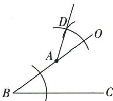

> [!success]- 必刷题
>
> > [!success] **【答案】** 详见解析
>
> > [!note]- **【解析】**
> > 【解】如图, $\angle OAD$ 即为所求.
> >
> > 
> >
> > 关键点按
> > 根据角平分线的性质分别用含 $\alpha$ 的代数式表示出 $\angle A_{1}OB_{1}, \angle A_{2}OB_{2}, \cdots,$ 即可归纳出此题规律，求得此题结果.
> >
> > ## 刷素养·
