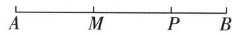

<!-- question-source:start -->
3[2025 福建福州期末, 中]如图, 线段 AB=24, 动点 P 从 A 出发, 以每秒 2 个单位长度的速度沿射线 AB 运动, M 为 AP 的中点. 点 P 的运动时间为 x 秒.

(1) 当 $x = 5$ 时, 求 $BM$ 的长.

(2) 当 P 在线段 AB 上运动时, 2BM-PB 是定值吗? 如果是, 请求出该定值; 如果不是, 请说明理由.

(3) 当 P 在射线 AB 上运动时, N 为 BP 的中点, 求 MN 的长.

<!-- question-source:end -->

![[Q00096472A1]]
