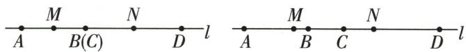

<!-- question-source:start -->
2[2025 浙江绍兴期末, 中]如图(1), 将线段 AB, CD 放置在直线 l 上, 点 B 与点 C 重合, AB = 10 cm, CD = 15 cm, 点 M 是线段 AC 的中点, 点 N 是线段 BD 的中点. 解答下列问题:

(1) $MN =$ \_\_\_\_.

(2) 将图(1)中的线段 AB 沿 DC 方向移动 x cm 至图(2)的位置(点 M 是线段 AC 的中点, 点 N 是线段 BD 的中点不变).

①当 x=7 时, 求 MN 的长.

②在移动的过程中,请直接写出 MN, AB, CD 之间满足的数量关系式.

  
图(1)  
图(2)

建议用时 35 分钟 答案 D37
<!-- question-source:end -->
