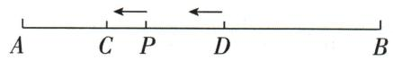

<!-- question-source:start -->
1[2025 辽宁沈阳期末, 中]如图, $P$ 是线段 $AB$ 上任意一点, $AB = 20 \mathrm{~cm}, C, D$ 两点分别从 $P, B$ 同时向 $A$ 点运动, 且 $C$ 点的运动速度为 $1 \mathrm{~cm} / \mathrm{s}, D$ 点的运动速度为 $4 \mathrm{~cm} / \mathrm{s}$ . 若运动时间为 $3 \mathrm{~s}$ 时, $CD = 5 \mathrm{~cm}$ , 则 $AP =$ \_\_\_\_ cm.

<!-- question-source:end -->

![[Q00102981A1]]
